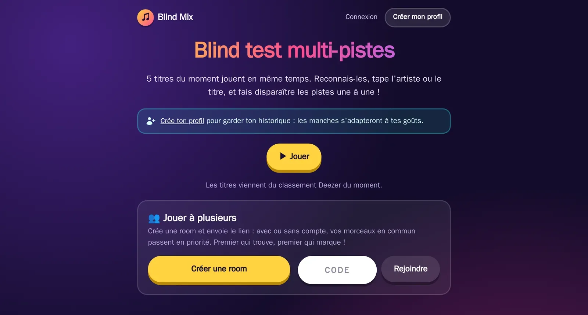
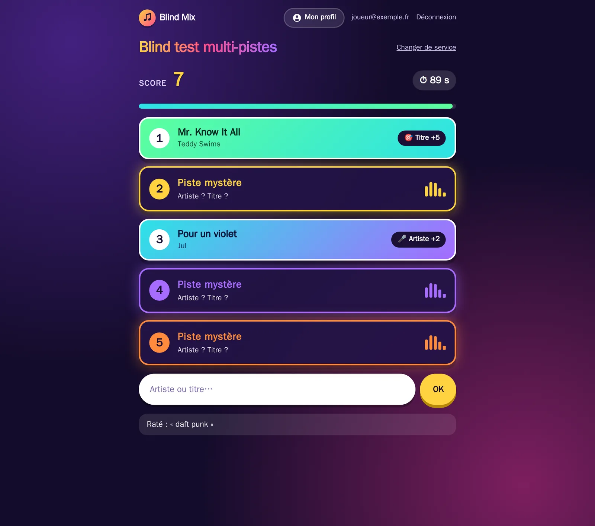
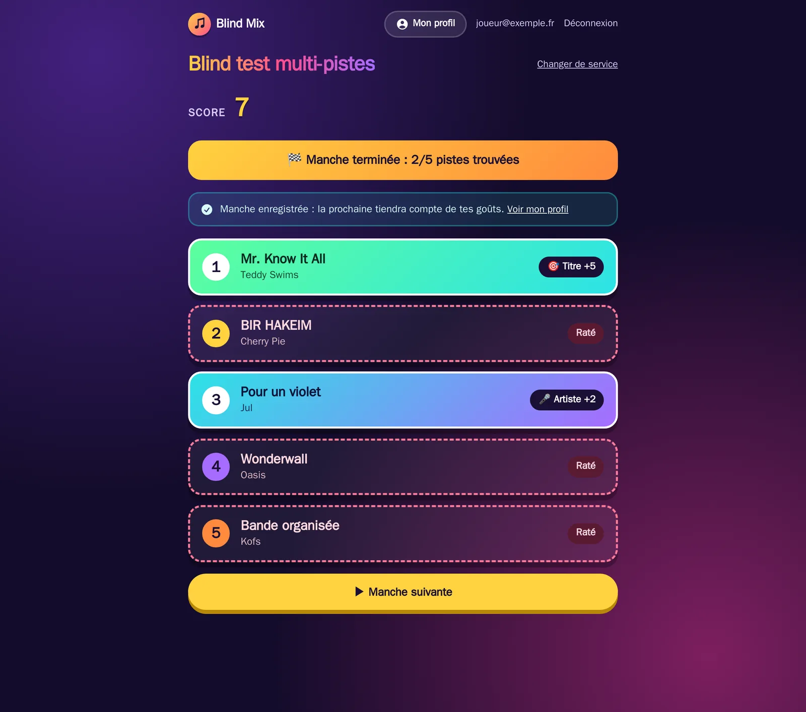
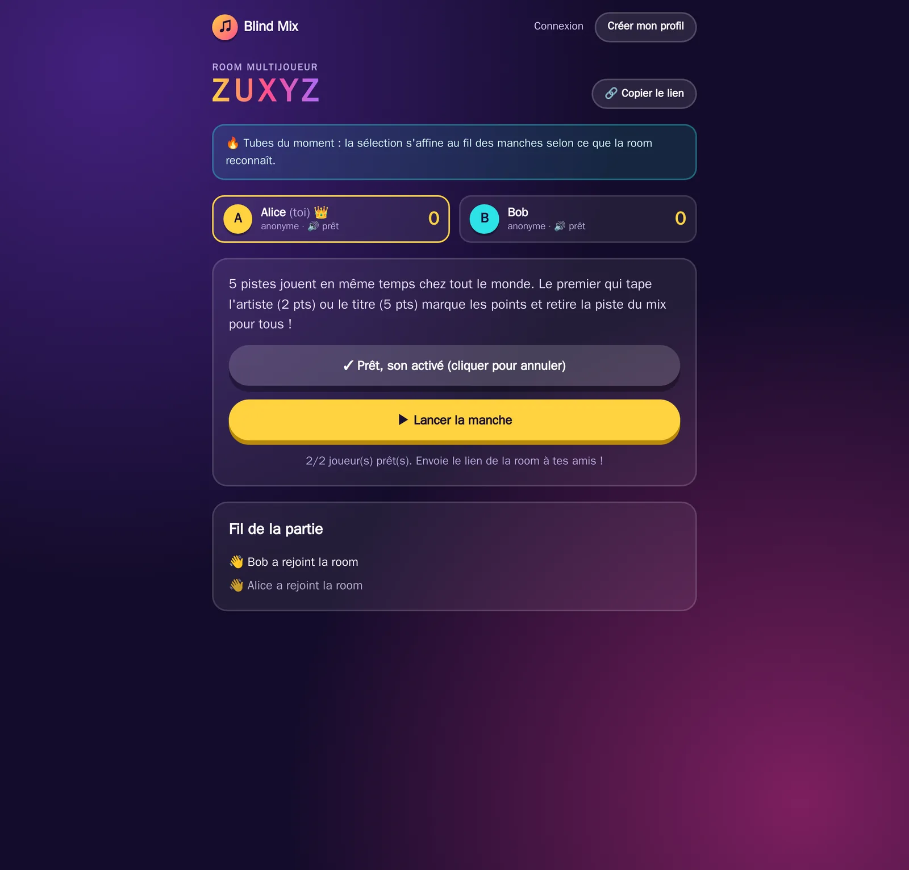
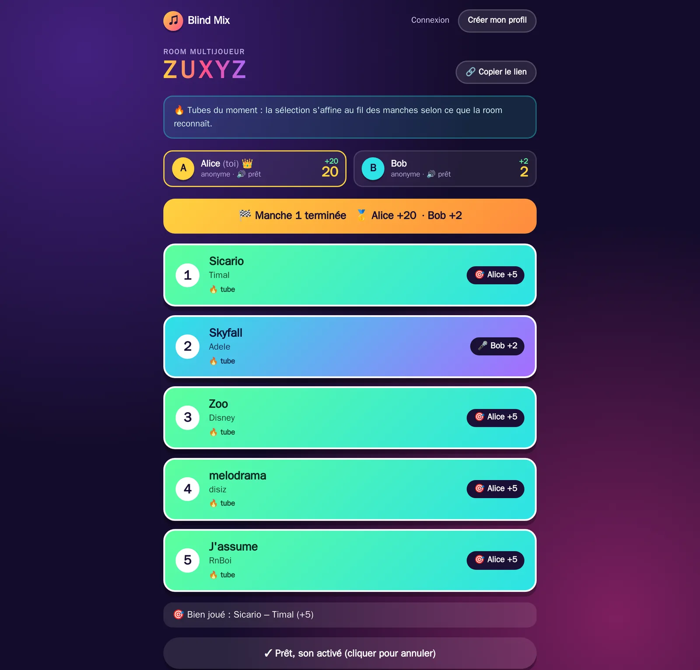
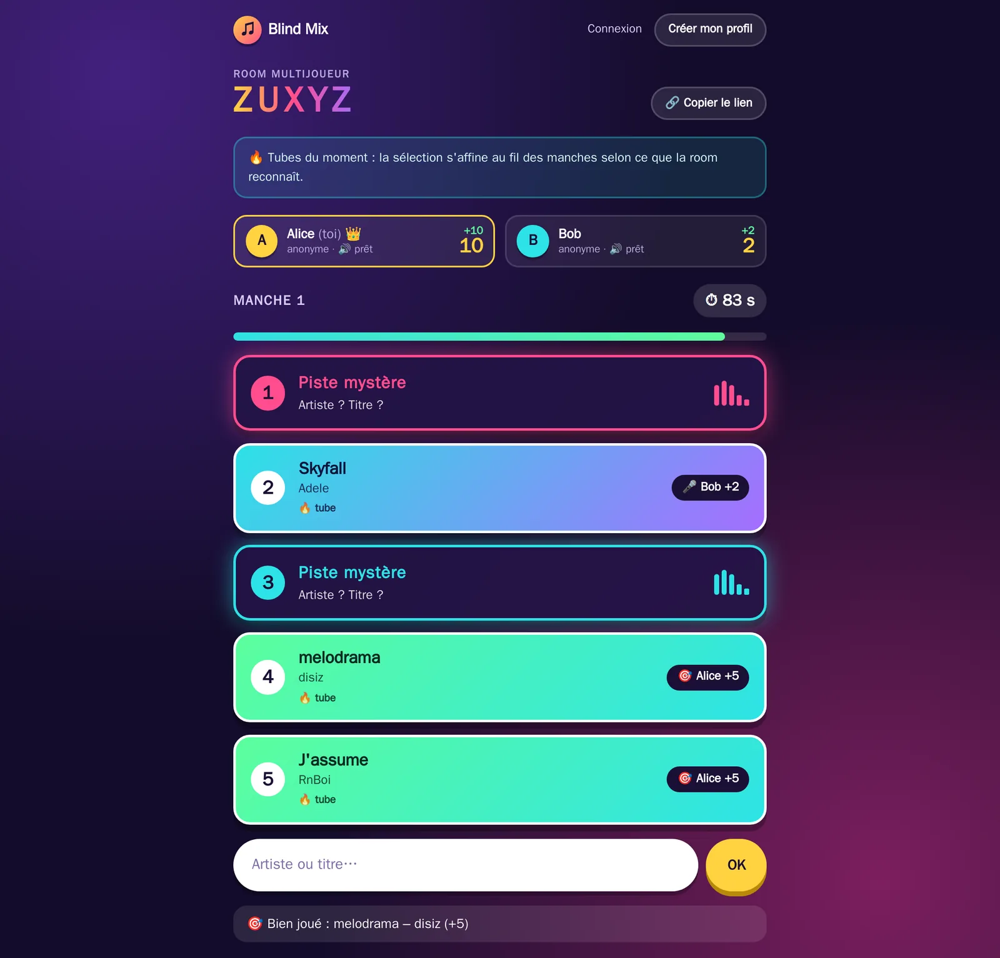
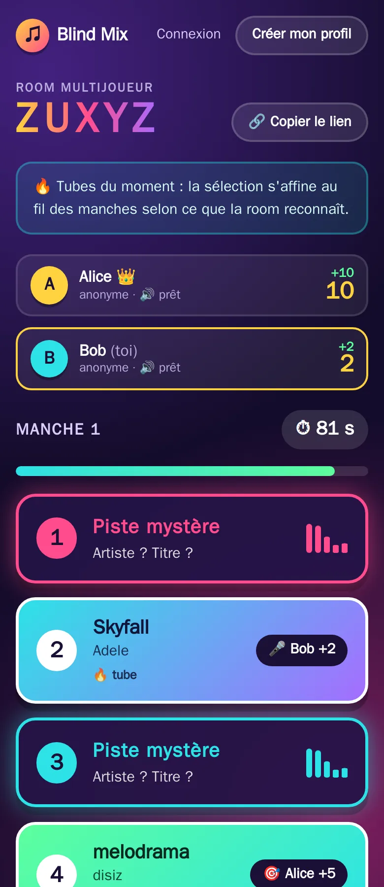
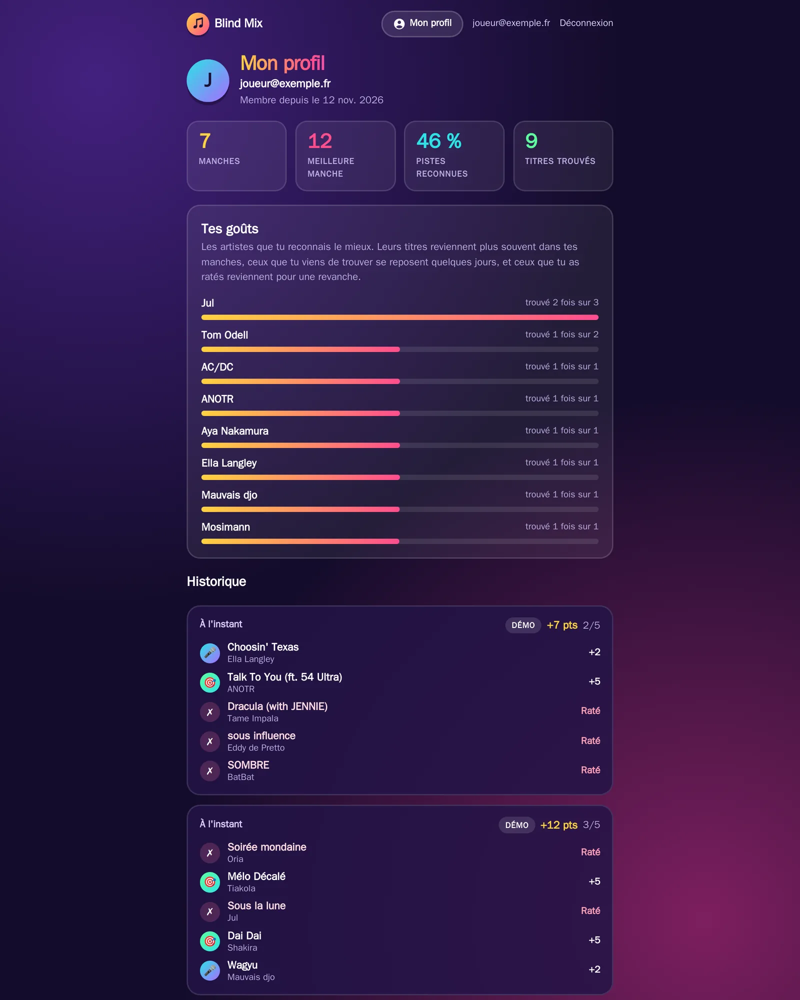
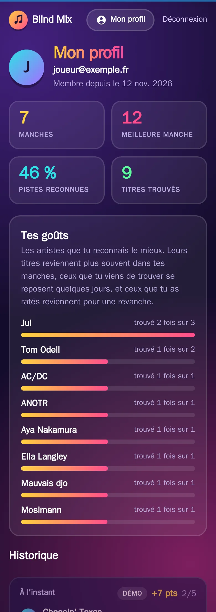
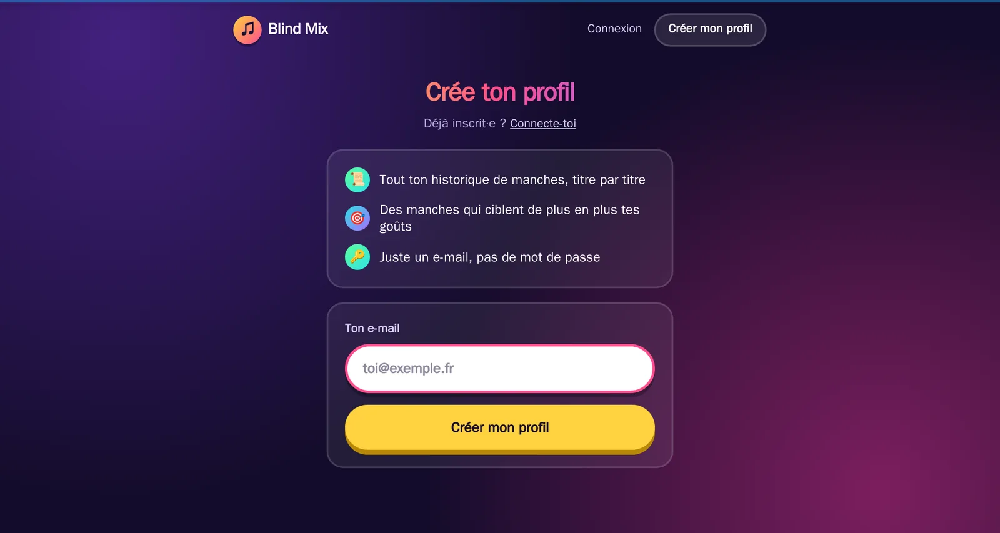

# Blind Mix

Un blind test où **5 de tes titres likés jouent en même temps**. Reconnais-les, tape l'artiste ou le titre, et fais disparaître les pistes du mix une à une avant la fin du chrono.

Connecte ton compte **Deezer** ou **Spotify**, ou essaie le **mode démo** (classement Deezer, sans compte). Avec un profil Blind Mix, tes manches sont enregistrées et les titres tirés s'adaptent peu à peu à tes goûts. Et à plusieurs, crée une **room** : vos morceaux en commun passent en priorité, et le premier qui trouve marque.



## Le jeu

<table>
  <tr>
    <td width="50%"></td>
    <td width="50%"></td>
  </tr>
  <tr>
    <td align="center"><em>Manche en cours : 5 pistes mixées, 90 secondes</em></td>
    <td align="center"><em>Fin de manche, enregistrée dans le profil</em></td>
  </tr>
</table>

- **Titre trouvé** : 5 points, la piste quitte le mix.
- **Artiste trouvé** : 2 points, la piste quitte aussi le mix (toutes les pistes de cet artiste, s'il y en a plusieurs).
- La saisie tolère les accents, la casse, la ponctuation, le « The » initial, les « (feat. …) » et les petites fautes de frappe.
- Le score se cumule de manche en manche.

## Jouer à plusieurs

Depuis l'accueil, **Créer une room** donne un code court (ex. `ZUXYZ`) et un lien à envoyer. Les autres le rejoignent avec ce code, connectés à leur profil ou en anonyme avec un simple pseudo.

<table>
  <tr>
    <td width="50%"></td>
    <td width="50%"></td>
  </tr>
  <tr>
    <td align="center"><em>Salle d'attente : joueurs, prêts, hôte 👑</em></td>
    <td align="center"><em>Fin de manche : qui a trouvé quoi</em></td>
  </tr>
</table>

<table>
  <tr>
    <td width="66%"></td>
    <td width="34%"></td>
  </tr>
  <tr>
    <td align="center"><em>Manche en cours, vue d'Alice</em></td>
    <td align="center"><em>La même manche chez Bob, sur mobile</em></td>
  </tr>
</table>

- **Mode course** : les 5 mêmes pistes jouent chez tout le monde. Le premier qui trouve marque les points et retire la piste du mix pour tous.
- **L'hôte** (le créateur, 👑) lance les manches. S'il part, le joueur suivant prend la main.
- **« Je suis prêt 🔊 »** : ce clic débloque le son du navigateur. Un joueur arrivé en cours de manche peut l'activer à tout moment.
- Chaque joueur peut connecter Deezer ou Spotify depuis la room pour **ajouter ses likes**, puis revient directement dans la room.

### Choix des morceaux

À chaque manche, la room choisit dans cet ordre ([`lib/blind_mix/rooms/picker.ex`](lib/blind_mix/rooms/picker.ex)) :

1. **Les morceaux en commun** : likés par au moins deux joueurs, d'autant plus prioritaires qu'ils sont partagés. Un même morceau est reconnu entre Deezer et Spotify (même artiste, même titre).
2. **Les likes de chacun**, à tour de rôle entre les joueurs, pondérés par leurs goûts.
3. **Les tubes du moment** (classement Deezer) quand ça ne suffit pas, ou quand personne n'a connecté de service.

Pour que la sélection s'affine **même entre anonymes** :

- **Pondération :** chaque joueur, anonyme compris, a un profil de goûts construit pendant la partie. Les artistes que la room reconnaît ressortent plus souvent, comme en solo.
- **Élargissement :** après chaque manche, la room va chercher d'autres titres des artistes trouvés et d'artistes similaires (API publique Deezer). Le choix s'éloigne peu à peu du seul classement pour coller à ce que la room connaît.

Les joueurs connectés à leur profil retrouvent leurs manches de room dans leur historique (ils n'y sont crédités que des pistes trouvées eux-mêmes), et leurs goûts enregistrés servent dès la première manche.

## Profil et goûts musicaux

<table>
  <tr>
    <td width="68%"></td>
    <td width="32%"></td>
  </tr>
  <tr>
    <td align="center"><em>Statistiques, goûts et historique</em></td>
    <td align="center"><em>Sur mobile</em></td>
  </tr>
</table>

Un profil se crée avec **une simple adresse e-mail** : on reçoit un lien de connexion, sans mot de passe (un mot de passe reste possible dans les réglages). Si le serveur n'a pas de service mail configuré, inscription et connexion se font par e-mail + mot de passe. Jouer sans profil reste possible, mais sans historique.



La page profil montre le nombre de manches, la meilleure manche, le pourcentage de pistes reconnues, les artistes que le joueur reconnaît le mieux et l'historique complet, titre par titre.

### Comment le tirage cible tes goûts

Les titres d'une manche viennent toujours de tes likes, mais certains sortent plus souvent que d'autres selon ton historique ([`lib/blind_mix/taste.ex`](lib/blind_mix/taste.ex)) :

| Situation | Effet sur la probabilité |
| --- | --- |
| Artiste déjà reconnu | augmente à chaque fois, jusqu'à ×3 |
| Artiste raté 3 fois sans jamais être trouvé | ×0,6 |
| Titre trouvé il y a moins de 3 jours | ×0,15 (puis ×0,6 jusqu'à 14 jours) |
| Titre raté, plus de 24 h après | ×1,6 (revanche) |

Le tirage reste aléatoire : un titre favorisé est plus probable, jamais garanti. Le profil est recalculé après chaque manche.

## Lancer le projet en local

Prérequis : Elixir 1.20 / OTP 29 (par exemple via asdf), Docker pour PostgreSQL.

```bash
docker compose up -d db   # PostgreSQL de développement (service du profil « dev »)
mix setup                 # dépendances, base de données, assets
mix phx.server            # http://localhost:4000
```

- Les e-mails de connexion s'affichent sur [`/dev/mailbox`](http://localhost:4000/dev/mailbox).
- Le mode démo marche sans aucune configuration. Pour Deezer et Spotify, renseigne les variables d'environnement de [`.env.example`](.env.example) : un service n'est proposé que si ses deux clés sont renseignées (sinon son bouton est masqué et son lien direct renvoie à l'accueil).
- En développement (ou avec `DEV_TOOLS=true`), des boutons 🛠 permettent de simuler une piste trouvée ou de terminer une manche, en solo comme en room (la piste est alors créditée au joueur qui clique).
- Après une modification de `config/` ou des dépendances (`mix.lock`), il faut redémarrer `mix phx.server` : sinon chaque page renvoie une erreur 500 « You must restart your server ».

Tests et vérifications avant commit :

```bash
mix precommit   # compilation sans warning, format, tests
```

## Déploiement

Le CI ([`.github/workflows/ci.yml`](.github/workflows/ci.yml)) lance les tests puis publie l'image Docker sur GitHub Container Registry : `ghcr.io/fyndir/blind_mix` (`latest` pour `master`, `sha-…` par commit, `1.2.3` pour un tag `v1.2.3`).

### Conteneur autonome

L'image fonctionne **sans aucune configuration** :

```bash
docker run -d -p 4000:4000 -v blindmix:/data ghcr.io/fyndir/blind_mix
```

ou, avec le compose du dépôt : `docker compose up -d`. Le site est alors sur http://localhost:4000.

Ce qui n'est pas fourni par l'environnement est pris en charge par le conteneur ([`rel/docker/entrypoint.sh`](rel/docker/entrypoint.sh)), et conservé dans le volume `/data` :

| Si absent | Le conteneur… |
| --- | --- |
| `DATABASE_URL` | démarre son propre PostgreSQL, accessible seulement de l'intérieur (données dans `/data/postgres`) |
| `SECRET_KEY_BASE` | génère une clé au premier démarrage et la réutilise ensuite |
| `MAIL_PROVIDER` | n'envoie aucun e-mail : inscription et connexion se font par **e-mail + mot de passe** |
| `PHX_HOST` | répond sur `localhost` |
| `DEEZER_*`, `SPOTIFY_*` | masque ces services : seul le mode démo est proposé |

Les migrations sont appliquées à chaque démarrage, et PostgreSQL est arrêté proprement avec le conteneur.

### Render (offre gratuite)

Le dépôt contient un blueprint [`render.yaml`](render.yaml) :

1. Crée une base gratuite sur [Neon](https://neon.tech) (région Francfort) et copie son URL de connexion (`postgresql://…?sslmode=require`).
2. Sur [Render](https://render.com) : **New → Blueprint**, choisis ce dépôt GitHub, puis colle l'URL Neon dans `DATABASE_URL`.
3. Le site est en ligne sur `https://blind-mix.onrender.com` (ou le nom attribué par Render). Chaque push sur `master` le redéploie, une fois le CI passé.

Ce qui est géré automatiquement :

- **Domaine :** il est lu dans `RENDER_EXTERNAL_HOSTNAME`, donc `PHX_HOST` est inutile.
- **Clé de session :** `SECRET_KEY_BASE` est générée par Render.
- **Connexion à Neon :** TLS est activé d'après le `sslmode` de l'URL.
- **Retours OAuth :** les URL de retour Deezer et Spotify valent `https://<domaine>/auth/<service>/callback`. Déclare-les dans leurs applications.

Limites de l'offre gratuite :

- Le service s'endort après 15 minutes sans visite. Le réveil prend environ 30 secondes, et les rooms en cours sont perdues.
- Le disque est effacé à chaque redémarrage, d'où la base externe : sans `DATABASE_URL`, la base embarquée repartirait de zéro.

### Variables d'environnement

Toutes sont optionnelles (voir [`.env.example`](.env.example)) :

| Variable | Rôle |
| --- | --- |
| `PHX_HOST` | Nom de domaine public (indispensable pour un accès autre que `localhost`) |
| `DATABASE_URL` | Base PostgreSQL externe, à la place de la base embarquée. TLS est activé si l'URL contient `sslmode=require` (Neon, Supabase), ou avec `DATABASE_SSL=true` |
| `SECRET_KEY_BASE` | Clé de signature des sessions (`mix phx.gen.secret`) |
| `MAIL_PROVIDER` | `resend`, `brevo`, `postmark` (avec `MAIL_API_KEY`) ou `smtp` (avec `SMTP_HOST`, `SMTP_PORT`, `SMTP_USERNAME`, `SMTP_PASSWORD`). Active la connexion par lien magique. |
| `MAIL_FROM` | Adresse d'expédition des e-mails |
| `DEEZER_APP_ID`, `DEEZER_SECRET`, `SPOTIFY_CLIENT_ID`, `SPOTIFY_CLIENT_SECRET` | Applications OAuth des services musicaux |

> Sans service mail, il n'y a pas de « mot de passe oublié » : un joueur qui perd le sien doit recréer un profil.

## Stack

Phoenix 1.8 et LiveView (rooms multijoueur : un processus par room, PubSub), PostgreSQL (Ecto), authentification par lien magique ou mot de passe (`phx.gen.auth`), Swoosh pour les e-mails, Req pour les API Deezer et Spotify.
